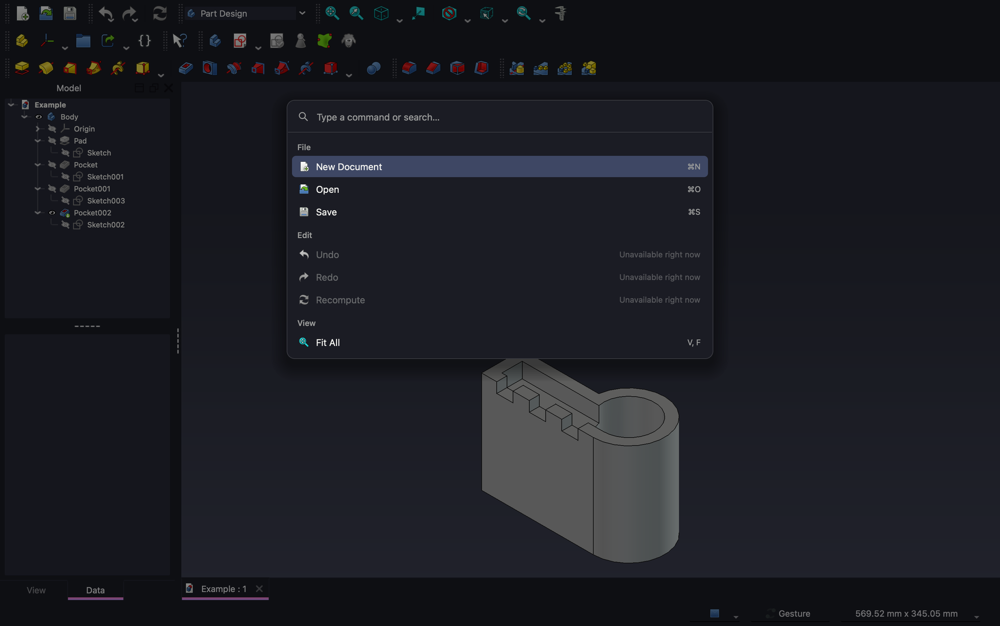

# CmdK: a command palette for FreeCAD

Press **Cmd+K** (Ctrl+K on Windows and Linux) and type the name of the command you want.
It runs the same action as the toolbar button, so you don't have to remember which
toolbar or menu it lives in.


## What it does

- **Search every command** FreeCAD has put in a menu or toolbar this session, by name,
  initials (`nd` finds New Document), workbench or tooltip.
- **Browse the toolbars.** With nothing typed it lists your recent commands, then one
  group per visible toolbar, in toolbar order.
- **Reach inside dropdown buttons.** Additive Box, the draw styles and your recent files
  each get their own row.
- **Switch workbench** by typing its name.
- **Follow your theme.** Colours are read from the active FreeCAD theme each time the
  palette opens.

Commands that need a document or a selection are greyed out and marked
"Unavailable right now".




## Install

Clone this repository into your FreeCAD `Mod` folder and restart FreeCAD:

```sh
git clone https://github.com/cjc-dev/freecad-cmdk.git
```

To find the folder, run this in FreeCAD's Python console and add `Mod` to the path it
prints:

```python
FreeCAD.getUserAppDataDir()
```

To uninstall, delete the folder.

## Keys

| Key | Action |
| --- | --- |
| Cmd+K / Ctrl+K | Open or close the palette |
| Up / Down, Page Up / Page Down | Move the selection |
| Enter | Run the selected command |
| Esc | Close |

## Limits

- Built and tested on FreeCAD 1.1.4 on macOS. Windows and Linux are untested.
- Commands from a workbench you haven't opened this session are not listed. Switch to
  the workbench first, which the palette can do.
- The shortcut is fixed at Cmd+K / Ctrl+K.

## Licence

MIT
