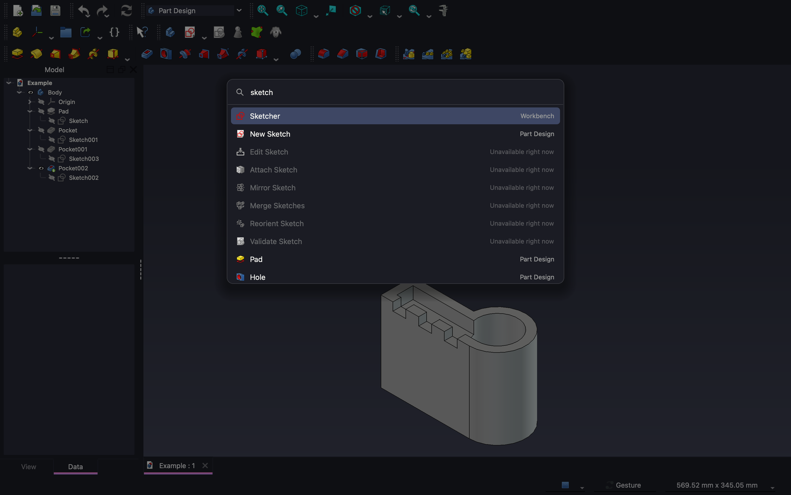
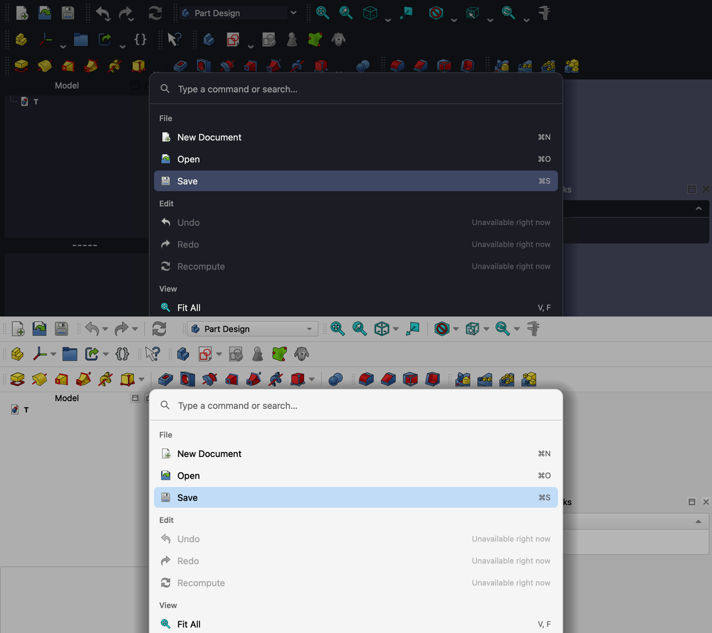

# CmdK: a command palette for FreeCAD

Press **Cmd+K** (Ctrl+K on Windows and Linux) and type the name of the command you want.
It runs the same action as the toolbar button, so you don't have to remember which
toolbar or menu it lives in.



## What it does

- **Search every command** FreeCAD has put in a menu or toolbar this session, by name,
  initials (`nd` finds New Document), workbench or tooltip.
- **Browse the toolbars.** With nothing typed it lists your recent commands, then one
  group per visible toolbar, in toolbar order.
- **Reach inside dropdown buttons.** Additive Box, the draw styles and your recent files
  each get their own row.
- **Switch workbench** by typing its name.
- **Follow your theme.** Colours are read from the active FreeCAD theme each time the
  palette opens.
- **Learn what you use.** Commands you run often rise in the results, and a "Most used"
  group appears above the toolbars.

Commands that need a document or a selection are greyed out and marked
"Unavailable right now".




## Install

Clone this repository into your FreeCAD `Mod` folder and restart FreeCAD:

```sh
git clone https://github.com/cjc-dev/freecad-cmdk.git
```

To find the folder, run this in FreeCAD's Python console and add `Mod` to the path it
prints:

```python
FreeCAD.getUserAppDataDir()
```

To uninstall, delete the folder.

## Keys

| Key | Action |
| --- | --- |
| Cmd+K / Ctrl+K | Open or close the palette |
| Up / Down, Page Up / Page Down | Move the selection |
| Enter | Run the selected command |
| Esc | Close |

## Changing the shortcut

Open `Tools → Customize → Keyboard`, pick the **CmdK** category, select **Command Palette**
and assign a new shortcut. The palette picks it up straight away.

## Size and text

Text follows FreeCAD's own font size. To change it, open the palette and run
**Command Palette Settings**, where you can set the text size, the panel width and how
many rows are shown. Changes apply the next time the palette opens.

## Usage statistics

The palette counts which commands you run from it, what you typed to find them, which
searches found nothing, and which command followed which. It uses this to rank results.

- The data is a single JSON file, `CmdK/usage.json`, in your FreeCAD user data folder. It
  is never sent anywhere.
- Recent-file and recent-macro rows are not recorded, so file names stay out of it.
- **Export Usage Stats** in the palette saves a copy you can attach to a forum thread or
  an issue. **Clear Usage Stats** deletes it.
- To turn recording off, untick it in **Command Palette Settings**.

## Limits

- Built and tested on FreeCAD 1.1.4 on macOS. Windows and Linux are untested, as are
  Qt5 builds such as FreeCAD 1.0.
- Commands from a workbench you haven't opened this session are not listed. Switch to
  the workbench first, which the palette can do.

## Licence

MIT
